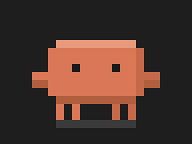

<div align="center">



# ✻ Clawd Pet

**Claude Codeのチャットの横のパネルに住む、小さなツンデレのピクセルペット。**
Claudeが作業中は歩き回り、あなたが離れると昼寝し、つつくと赤くなり、マンガみたいな吹き出しでしゃべります。

[English](README.md) · [Українська](README.uk.md) · **日本語\*** · [한국어*](README.ko.md)

<sub>非公式のファンメイドMODです。Anthropicとは提携しておらず、承認・後援も受けていません。
「Claude」と「Claude Code」はAnthropicの商標です。ペットのピクセルアートはこのプロジェクトのオリジナルです。</sub>

<sub>\* 機械翻訳のため、誤りが含まれている可能性があります。</sub>

</div>

---

## できること

| | |
|---|---|
| 🐾 **チャットの横に住む** | アニメーションするピクセルペットのいるサイドパネル。ターミナルではテキストのセルで、Claudeデスクトップアプリではくっきりした画像で描かれます。 |
| 🖱️ **クリックしてみて** | ハート、照れ、またはツンデレの「ふん!」とそっぽ。親友にはときどきキラキラの目も。 |
| 💬 **吹き出し** | セッション開始時にあいさつし、最初のプロンプトまでそのまま待っています。タスク、ツールの実行、エラー、完成した返答にコメントし、ひまなときはおしゃべり。標準は組み込みのセリフ、オプションでAIが書くセリフも。 |
| 💞 **好感度** | 一緒に過ごすほど、やさしくなります。4段階の関係レベルで、見られるリアクションが変わります。セッションをまたいで保存。 |
| 😴 **眠る** | 静かな時間が数分続くと、うとうと(Zzzつき)。クリックで起きて、寝てないと言い張ります。 |
| 🎭 **気分** | ツールが失敗すると涙、ターンが終わるとぴょん、Claudeを止めるとびっくり。 |
| 🌅 **あいさつ** | 時間帯に合わせてあいさつし、深夜3時のセッションには一言あります。 |
| 🎨 **6つのスキン** | クラシック、ミント、ラベンダー、スカイ、ゴールド、ナイト。パネルのアクセントカラーも一緒に変わります。 |
| 🧹 **クリーンチャット** *(オプション)* | ツールの行、スピナー、フッターのヒントをパネルに移し、各返答の上に見出しを付けるので、チャットには会話だけが残ります。 |
| 📊 **使用量をひと目で** | コンテキストの使用率をバーで、5時間と7日間の制限をリセット時刻つきで、セッションのコストを推定で表示。 |
| ⚡ **クイックコマンド** | `/compact`、`/context`、`/usage`、`/model`をワンクリックで。チャットを消すものはありません。 |
| 🌍 **どんな言語でも** | 英語、ウクライナ語、日本語、韓国語を内蔵し、自動で選ばれます。ほかの言語はリクエストに応じて、同意のうえAIがClawdを一度だけ翻訳します(ロシア語を除く — 理由があります)。 |

## インストール

Claude Codeのターミナルセッションのプロンプトで:

```
/plugin install clawd-pet --marketplace y-teitelman/clawd-pet
```

`y`と答えてマーケットプレイスを追加し、範囲(自分用、または1つのプロジェクト用)を選びます。

またはシェルから:

```
claude plugin install clawd-pet --marketplace y-teitelman/clawd-pet
```

そのあとClaude Codeを再起動(または新しいセッションを開始)します。初回起動時にペットが設定を開くので、好きなものを選んで**完了**を押してください。

> 幅144列以上のターミナルでは、パネルが自動で開きます。それより狭いウィンドウでは`/clawd`と入力してください。

## コマンド

| コマンド | 内容 |
|---|---|
| `/clawd` | ペットのパネルを開く |
| `/clawd-settings` | 設定を開く(パネルの見出しにある**☰**ボタンからも) |
| `/clawd-chat` | クリーンチャットのオン/オフ |

## 設定

すべて**☰**か`/clawd-settings`からいつでも変更でき、セッション間で保存されます。

| 設定 | 選択肢 | 初期値 |
|---|---|---|
| 言語 | 自動 · Українська · English · 日本語 · 한국어 · その他… | 自動 |
| AIのセリフ | オフ · オン | **オフ** |
| プロンプトをAIに見せる | オフ · オン *(AIのセリフがオンのとき表示)* | オン |
| おしゃべり度 | よく · ふつう · たまに · 無口 | ふつう |
| クリーンチャット | オフ · オン | オフ |
| 好感度 | オフ · オン | オン |
| 好きなリアクション | ランダム · ハート · 照れ · ツンデレ *(好感度がオフのとき表示)* | ランダム |
| 色 | クラシック · ミント · ラベンダー · スカイ · ゴールド · ナイト | クラシック |
| 寝るまで | しない · 5 · 15 · 30分 | 5分 |
| 時間帯のあいさつ | オフ · オン | オン |
| イベントに反応 | オフ · オン | オン |
| 使用量ブロック | オフ · オン | オン |
| クイックコマンド | オフ · オン | オン |

**言語「自動」**は、まずシステムのロケールから始まり、そのあとプロンプトを書く言語に合わせます。

**言語「その他…」**は、好きな言語の名前を(どの言語で書いても)たずね、同意すると、Clawdが表示するすべてをAIが一度だけ翻訳します(Haikuのトークンで約1万)。翻訳は保存され、アップデートで新しい言葉が増えると、設定から再翻訳を提案します。ロシア語は利用できません。

設定のいちばん下にある**設定をリセット**は、確認のあとですべてを初期値に戻します。好感度と翻訳はそのまま残ります。

## 好感度

クリックや返答の完了ごとに、好感度が少し上がります(1日の上限があるので、連打しても無駄です)。10秒間に4回つつくと下がります。パネルではハートで表示されます:

| レベル | ハート | よく見られるもの |
|---|---|---|
| よそよそしい | ♥♡♡♡♡ | ツンデレ |
| 顔見知り | ♥♥♡♡♡ | いろいろ |
| 友だち | ♥♥♥♡♡ | ハートと照れ |
| 親友 | ♥♥♥♥♥ | ハートと、まれに ✨ キラキラの目 |

好感度をオフにすると、代わりに好きなリアクションを選べます。**好感度をリセット**は設定にあり、リセット前に確認します。ハートの横の**?**を押すと、今日の獲得状況と一緒に、このルールをパネルで見られます。

## AIのセリフ: コストとプライバシー

AIのセリフは**初期設定ではオフ**です。オンにすると:

- 1つのセリフは**Claude Haiku**への短いリクエスト1回で、あなたのClaude Codeセッション自身の認証情報で送られ、その使用量に数えられます(`/usage`でMODの分を確認できます)。1セリフは出力約60トークンで、上限は1セッション200セリフ。超えると組み込みのセリフに戻ります。
- 状況にコメントするため、モデルが見るのは: ツール名とその短いラベル(コマンド、ファイル名、検索パターン)、返答にかかった時間、そして**プロンプトをAIに見せる**がオンのときだけ、プロンプトの最初の200文字です。
- ほかにはどこにも送信されません。AIのセリフがオフなら、何も送信されません。

## クリーンチャット

オンにすると、チャットにはあなたのメッセージとClaudeの返答だけが、それぞれ見出しつきで表示されます。代わりにパネルに表示されるのは:

- **状態:** Claudeが今していることと、タイマー
- **アクション:** すべてのツール呼び出し、`✓` 完了、`✗` 失敗
- **ヒント:** ステータスライン、モードのラベル、プロンプト下のショートカットのヒント(権限モードはshift+tabで切り替えられるプロンプトの下に残ります)

失敗したツール呼び出しと権限の確認は、常にチャットに残ります。**ctrl+o**でいつでも全ログを表示できます。

## 動作環境

- MOD(hooks module)に対応したClaude Code
- **ターミナルでは:** トゥルーカラー。Windowsでは**Windows Terminal**を使ってください。古いコンソールではピクセルがうまく描けないことがあります。macOSではiTerm2、Ghostty、WezTermがおすすめです。
- マウスクリックには、クリックをアプリに渡すターミナルが必要です(Windows Terminal、iTerm2、ほとんどのLinuxターミナルは対応)。
- **Claudeデスクトップアプリでは:** そのまま動き、クリックも使えます。待機、作業、睡眠は画像の中でアニメーションするので、パネルはイベントのときだけ再描画されます。

## 困ったときは

- **パネルがない?** `/clawd`と入力してください。144列未満では、呼ばれるまでパネルは待っています。
- **ペットが縞模様やおかしな色に見える?** ターミナルが256色に制限されているのかもしれません。トゥルーカラー対応のターミナルを試してください。
- **マウスの下で行がハイライトされる?** 普通のテキストなのはペットの縁だけで、体はターミナルのホバーハイライトが見えないように描かれています。それでも見える場合は、ターミナルのホバーの描き方が違います。

## バージョン履歴

各バージョンの変更点は[CHANGELOG.md](CHANGELOG.md)(英語)にあります。すべてのバージョンは[GitHubのリリース](https://github.com/y-teitelman/clawd-pet/releases)にもなっています。新しいバージョンの通知を受け取るには、リポジトリをウォッチしてください(Watch → Custom → Releases)。

## 開発

```
claude plugin validate .          # マニフェストとモジュールを確認
claude plugin test .              # tests/を実行
node scripts/render-assets.mjs .  # スプライトのコードからassets/icon.pngとassets/demo.gifを再描画
```

スプライトは`hooks/register.tsx`の`// <sprite>`マーカーの間にある1つの純粋関数で描かれます。アセット用スクリプトは同じコードをレンダリングするので、READMEはいつも本物のペットを表示します。

---

<div align="center"><sub><a href="LICENSE">MIT License</a> · by <a href="https://github.com/y-teitelman">KypiCTiHka</a> · made with ♥ and a lot of pokes</sub></div>
