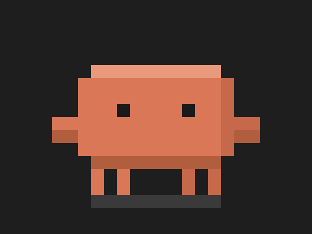

<div align="center">



# ✻ Clawd Pet

**Claude Code 채팅 옆 패널에 사는 작은 츤데레 픽셀 펫.**
Claude가 일하는 동안 걸어 다니고, 자리를 비우면 낮잠을 자고, 찌르면 얼굴이 빨개지고, 만화 같은 말풍선으로 말해요.

[English](README.md) · [Українська](README.uk.md) · [日本語*](README.ja.md) · **한국어\***

<sub>비공식 팬 메이드 모드입니다. Anthropic과 제휴하지 않았으며 승인이나 후원도 받지 않았습니다.
"Claude"와 "Claude Code"는 Anthropic의 상표입니다. 펫의 픽셀 아트는 이 프로젝트의 오리지널입니다.</sub>

<sub>\* 기계 번역이라 오류가 있을 수 있습니다.</sub>

</div>

---

## 할 수 있는 것

| | |
|---|---|
| 🐾 **채팅 옆에 살아요** | 움직이는 픽셀 펫이 있는 사이드 패널. 터미널에서는 텍스트 셀로, Claude 데스크톱 앱에서는 선명한 그림으로 그려져요. |
| 🖱️ **클릭해 보세요** | 하트, 수줍음, 또는 츤데레식 "흥!"과 고개 돌리기. 절친에게는 가끔 반짝이는 눈도. |
| 💬 **말풍선** | 세션이 시작되면 인사하고, 첫 프롬프트까지 인사를 띄워 둬요. 작업, 도구 실행, 오류, 완성된 답변에 한마디 하고, 한가할 땐 수다도 떨어요. 기본은 내장 대사, 선택하면 AI가 쓰는 대사도. |
| 💞 **호감도** | 함께할수록 더 다정해져요. 네 단계의 관계 레벨에 따라 보이는 반응이 달라져요. 세션 간에 저장돼요. |
| 😴 **잠** | 조용한 시간이 몇 분 이어지면 꾸벅꾸벅(Zzz와 함께). 클릭하면 깨어나서 안 잤다고 우겨요. |
| 🎭 **기분** | 도구가 실패하면 눈물, 턴이 끝나면 깡충, Claude를 멈추면 깜짝. |
| 🌅 **인사** | 시간대에 맞춰 인사하고, 새벽 3시 세션에는 할 말이 있어요. |
| 🎨 **여섯 가지 스킨** | 클래식, 민트, 라벤더, 하늘, 골드, 밤 — 패널의 강조 색도 함께 바뀌어요. |
| 🧹 **깔끔한 채팅** *(선택)* | 도구 줄, 스피너, 하단 힌트를 패널로 옮기고 각 답변 위에 제목을 달아서, 채팅에는 대화만 남아요. |
| 📊 **사용량 한눈에** | 컨텍스트 사용률을 막대로, 5시간·7일 한도를 초기화 시각과 함께, 세션 비용을 추정치로 보여줘요. |
| ⚡ **빠른 명령** | `/compact`, `/context`, `/usage`, `/model`을 클릭 한 번으로. 채팅을 지우는 건 없어요. |
| 🌍 **어떤 언어든** | 영어, 우크라이나어, 일본어, 한국어가 내장되어 자동으로 선택돼요. 다른 언어는 요청하면 동의 후 AI가 Clawd를 한 번 번역해요(러시아어 제외 — 이유가 있어요). |

## 설치

Claude Code 터미널 세션의 프롬프트에서:

```
/plugin install clawd-pet --marketplace y-teitelman/clawd-pet
```

`y`로 답해 마켓플레이스를 추가하고, 범위(나만, 또는 한 프로젝트)를 고르세요.

또는 셸에서:

```
claude plugin install clawd-pet --marketplace y-teitelman/clawd-pet
```

그다음 Claude Code를 다시 시작(또는 새 세션을 시작)하세요. 처음 실행하면 펫이 설정을 여니까, 원하는 대로 고르고 **완료**를 누르세요.

> 너비가 144열 이상인 터미널에서는 패널이 저절로 열려요. 더 좁은 창에서는 `/clawd`를 입력하세요.

## 명령어

| 명령어 | 하는 일 |
|---|---|
| `/clawd` | 펫 패널 열기 |
| `/clawd-settings` | 설정 열기(패널 제목의 **☰** 버튼으로도 가능) |
| `/clawd-chat` | 깔끔한 채팅 켜기/끄기 |

## 설정

모든 설정은 **☰** 또는 `/clawd-settings`에서 언제든 바꿀 수 있고, 세션 간에 저장돼요.

| 설정 | 옵션 | 기본값 |
|---|---|---|
| 언어 | 자동 · Українська · English · 日本語 · 한국어 · 기타… | 자동 |
| AI 대사 | 끄기 · 켜기 | **끄기** |
| 내 프롬프트를 AI에게 보여주기 | 끄기 · 켜기 *(AI 대사가 켜져 있을 때 표시)* | 켜기 |
| 수다 정도 | 자주 · 보통 · 가끔 · 조용히 | 보통 |
| 깔끔한 채팅 | 끄기 · 켜기 | 끄기 |
| 호감도 | 끄기 · 켜기 | 켜기 |
| 좋아하는 반응 | 무작위 · 하트 · 수줍음 · 츤데레 *(호감도가 꺼져 있을 때 표시)* | 무작위 |
| 색상 | 클래식 · 민트 · 라벤더 · 하늘 · 골드 · 밤 | 클래식 |
| 잠들기까지 | 안 함 · 5 · 15 · 30분 | 5분 |
| 시간대별 인사 | 끄기 · 켜기 | 켜기 |
| 이벤트에 반응 | 끄기 · 켜기 | 켜기 |
| 사용량 블록 | 끄기 · 켜기 | 켜기 |
| 빠른 명령 | 끄기 · 켜기 | 켜기 |

**언어 "자동"**은 먼저 시스템 로캘에서 시작해서, 이후에는 프롬프트를 쓰는 언어를 따라가요.

**언어 "기타…"**는 원하는 언어의 이름을(어떤 언어로 써도) 묻고, 동의하면 Clawd가 보여주는 모든 것을 AI가 한 번 번역해요(Haiku 토큰 약 1만 개). 번역은 저장되고, 업데이트로 새 단어가 생기면 설정에서 다시 번역할지 물어봐요. 러시아어는 사용할 수 없어요.

설정 맨 아래의 **설정 초기화**는 확인 후 모든 것을 기본값으로 되돌려요. 호감도와 번역은 그대로 남아요.

## 호감도

클릭할 때마다, 답변이 끝날 때마다 호감도가 조금씩 올라요(하루 한도가 있어서 연타해도 소용없어요). 10초 안에 네 번 찌르면 내려가요. 패널에는 하트로 표시돼요:

| 레벨 | 하트 | 가장 자주 보는 것 |
|---|---|---|
| 서먹함 | ♥♡♡♡♡ | 츤데레 |
| 아는 사이 | ♥♥♡♡♡ | 이것저것 |
| 친구 | ♥♥♥♡♡ | 하트와 홍조 |
| 절친 | ♥♥♥♥♥ | 하트, 그리고 가끔 ✨ 반짝이는 눈 |

호감도를 끄면 대신 좋아하는 반응을 고를 수 있어요. **호감도 초기화**는 설정에 있고, 초기화하기 전에 확인해요. 하트 옆의 **?**를 누르면 오늘 얻은 것과 함께 이 규칙을 패널에서 바로 볼 수 있어요.

## AI 대사: 비용과 개인정보

AI 대사는 **기본적으로 꺼져 있어요**. 켜면:

- 대사 하나는 **Claude Haiku**에 보내는 짧은 요청 한 번이고, 여러분의 Claude Code 세션 자체 인증 정보로 보내져 그 사용량에 포함돼요(`/usage`에서 모드 몫을 볼 수 있어요). 대사 하나는 출력 약 60토큰이고, 세션당 200개가 한도예요. 넘으면 내장 대사로 돌아가요.
- 상황에 한마디 하려고 모델이 보는 것: 도구 이름과 짧은 라벨(명령, 파일 이름, 검색 패턴), 답변에 걸린 시간, 그리고 **내 프롬프트를 AI에게 보여주기**가 켜져 있을 때만 프롬프트의 처음 200자.
- 다른 곳으로는 아무것도 보내지 않아요. AI 대사가 꺼져 있으면 아무것도 보내지 않아요.

## 깔끔한 채팅

켜면 채팅에는 여러분의 메시지와 Claude의 답변만, 각각 제목과 함께 표시돼요. 대신 패널에는:

- **상태:** Claude가 지금 하고 있는 일과 타이머
- **동작:** 모든 도구 호출, `✓` 완료, `✗` 실패
- **힌트:** 상태 줄, 모드 라벨, 프롬프트 아래의 단축키 힌트(권한 모드는 shift+tab으로 바꾸는 프롬프트 아래에 남아요)

실패한 도구 호출과 권한 확인은 항상 채팅에 남아요. **ctrl+o**로 언제든 전체 로그를 볼 수 있어요.

## 요구 사항

- 모드(hooks module)를 지원하는 Claude Code
- **터미널에서는:** 트루 컬러. Windows에서는 **Windows Terminal**을 쓰세요. 예전 콘솔에서는 픽셀이 제대로 안 그려질 수 있어요. macOS에서는 iTerm2, Ghostty, WezTerm이 가장 잘 맞아요.
- 마우스 클릭에는 클릭을 앱에 전달하는 터미널이 필요해요(Windows Terminal, iTerm2, 대부분의 Linux 터미널은 지원).
- **Claude 데스크톱 앱에서는:** 바로 동작하고 클릭도 돼요. 대기, 작업, 잠은 그림 안에서 움직여서 패널은 이벤트가 있을 때만 다시 그려져요.

## 문제 해결

- **패널이 없나요?** `/clawd`를 입력하세요. 144열 미만에서는 부를 때까지 패널이 기다려요.
- **펫이 줄무늬거나 이상한 색으로 보이나요?** 터미널이 256색으로 제한되어 있을 거예요. 트루 컬러 터미널을 써 보세요.
- **마우스 아래에서 줄이 강조되나요?** 일반 텍스트는 펫의 가장자리뿐이고, 몸통은 터미널의 호버 강조가 보이지 않게 그려져요. 그래도 보인다면 터미널이 호버를 다르게 그리는 거예요.

## 버전 기록

버전마다 바뀐 점은 [CHANGELOG.md](CHANGELOG.md)(영어)에 있어요. 모든 버전은 [GitHub 릴리스](https://github.com/y-teitelman/clawd-pet/releases)로도 올라가요. 새 버전 소식을 받으려면 저장소를 지켜보세요(Watch → Custom → Releases).

## 개발

```
claude plugin validate .          # 매니페스트와 모듈 확인
claude plugin test .              # tests/ 실행
node scripts/render-assets.mjs .  # 스프라이트 코드로 assets/icon.png와 assets/demo.gif 다시 그리기
```

스프라이트는 `hooks/register.tsx`의 `// <sprite>` 표시 사이에 있는 순수 함수 하나가 그려요. 에셋 스크립트가 같은 코드를 렌더링하니까, README는 언제나 진짜 펫을 보여줘요.

---

<div align="center"><sub><a href="LICENSE">MIT License</a> · by <a href="https://github.com/y-teitelman">KypiCTiHka</a> · made with ♥ and a lot of pokes</sub></div>
