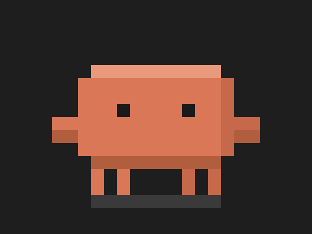

<div align="center">



# ✻ Clawd Pet

**A tiny tsundere pixel pet that lives in a pane beside your Claude Code chat.**
It walks while Claude works, naps when you're away, blushes when you poke it, and talks in comic-strip bubbles.

**English** · [Українська](README.uk.md) · [日本語*](README.ja.md) · [한국어*](README.ko.md)

<sub>Unofficial fan-made mod. Not affiliated with, endorsed by, or sponsored by Anthropic.
"Claude" and "Claude Code" are trademarks of Anthropic. The pet's pixel art is original to this project.</sub>

<sub>\* Machine translation, may contain mistakes.</sub>

</div>

---

## What it does

| | |
|---|---|
| 🐾 **Lives beside the chat** | A side pane with an animated pixel pet: drawn in text cells in the terminal, as a crisp picture in the Claude desktop app. |
| 🖱️ **Click it** | Hearts, shyness, or a tsundere *"hmph!"* and turn-away. Best friends sometimes get star eyes. |
| 💬 **Speech bubbles** | Says hi when a session starts and keeps the welcome up until your first prompt. Comments on your tasks, tool runs, errors and finished replies, plus idle chatter. Built-in lines by default, or optional AI-written lines. |
| 💞 **Affection** | The more you hang out, the sweeter it gets: four relationship levels shift which reactions you see. Saved across sessions. |
| 😴 **Sleeps** | Dozes off after a few quiet minutes (Zs and all). Click to wake it. It will insist it wasn't asleep. |
| 🎭 **Moods** | Sheds a tear when a tool fails, hops when a turn finishes, startles when you stop Claude. |
| 🌅 **Greetings** | Says hello by time of day, and has opinions about 3 a.m. sessions. |
| 🎨 **Six skins** | Classic, Mint, Lavender, Sky, Gold and Night — the pane's accent color follows along. |
| 🧹 **Clean chat** *(optional)* | Moves tool rows, the spinner and the footer hints into the pane, and puts a clear header above each reply, so the chat holds only the conversation. |
| 📊 **Usage at a glance** | Context fill with a bar, your 5-hour and 7-day limits with reset times, and the session cost estimate. |
| ⚡ **Quick commands** | One-click `/compact`, `/context`, `/usage` and `/model`. Nothing that wipes the chat. |
| 🌍 **Any language** | English, Ukrainian, Japanese and Korean built in, picked automatically. Any other language on request: the AI translates Clawd once, after you agree (except Russian — there are reasons). |

## Install

At the prompt of a Claude Code terminal session:

```
/plugin install clawd-pet --marketplace y-teitelman/clawd-pet
```

Answer `y` to add the marketplace, then pick a scope (for yourself, or for one project).

Or from a shell:

```
claude plugin install clawd-pet --marketplace y-teitelman/clawd-pet
```

Then restart Claude Code (or open a new session). On first launch the pet opens its settings: pick what you like and press **Done**.

> The pane opens by itself in terminals at least 144 columns wide. In a narrower window, type `/clawd`.

## Commands

| Command | What it does |
|---|---|
| `/clawd` | Open the pet pane |
| `/clawd-settings` | Open settings (also: the **☰** button in the pane's header) |
| `/clawd-chat` | Toggle clean chat on and off |

## Settings

Everything is changeable at any time from **☰** or `/clawd-settings`, and is saved between sessions.

| Setting | Options | Default |
|---|---|---|
| Language | Auto · Українська · English · 日本語 · 한국어 · Own… | Auto |
| AI-written lines | Off · On | **Off** |
| Share my prompt with the AI | Off · On *(shown when AI lines are on)* | On |
| Chattiness | Often · Normal · Rarely · Silent | Normal |
| Clean chat | Off · On | Off |
| Affection | Off · On | On |
| Favorite reaction | Random · Hearts · Shy · Tsundere *(shown when affection is off)* | Random |
| Color | Classic · Mint · Lavender · Sky · Gold · Night | Classic |
| Fall asleep after | Never · 5 · 15 · 30 min | 5 min |
| Time-of-day greetings | Off · On | On |
| React to events | Off · On | On |
| Usage block | Off · On | On |
| Quick commands | Off · On | On |

**Language: Auto** starts from your system locale, then follows the language you write your prompts in.

**Language: Own…** asks for any language by name (written in any language), and after you agree the AI translates everything Clawd shows, once (roughly 10k Haiku tokens). The translation is kept; when an update brings new words, the settings offer to translate again. Russian is not available.

**Reset settings** at the bottom of settings returns everything to the defaults after you confirm; affection and a translation stay.

## Affection

Each poke and each finished reply raises affection a little (with a daily cap, so spamming doesn't help). Poking four times in ten seconds lowers it. The pane shows it as hearts:

| Level | Hearts | What you'll see most |
|---|---|---|
| Reserved | ♥♡♡♡♡ | tsundere |
| Acquainted | ♥♥♡♡♡ | a mix |
| Friends | ♥♥♥♡♡ | hearts and blushing |
| Best friends | ♥♥♥♥♥ | hearts, and rare ✨ star eyes |

Turn affection off to pick a favorite reaction instead. **Reset affection** lives in settings and asks before it resets. The **?** next to the hearts shows these rules right in the pane, with what you have earned today.

## AI-written lines: cost and privacy

AI lines are **off by default**. When you turn them on:

- Each line is one short request to **Claude Haiku**, made with your Claude Code session's own credentials and counted in its usage (`/usage` shows how much came from mods). A line is about 60 output tokens; there's a cap of 200 lines per session, after which it falls back to built-in lines.
- To comment on what's happening, the model sees: the tool name and its short label (a command, a file name or a search pattern), the time a reply took, and — only if **Share my prompt** is on — the first 200 characters of your prompt.
- Nothing is sent anywhere else. With AI lines off, nothing is sent at all.

## Clean chat

When on, the chat shows only your messages and Claude's replies, each under its own header. The pane shows instead:

- **Status:** what Claude is doing right now, with a timer
- **Activity:** every tool call, `✓` done, `✗` failed
- **Hints:** the status line, mode labels and the shortcut hints from under the prompt (the permission mode stays under the prompt, where shift+tab switches it)

Failed tool calls and permission prompts always stay in the chat. Press **ctrl+o** for the full transcript any time.

## Requirements

- Claude Code with mod (hooks module) support
- **In a terminal:** true color. On Windows, use **Windows Terminal**; the legacy console may draw the pixels poorly. On macOS, iTerm2, Ghostty or WezTerm work best.
- Mouse clicks need a terminal that passes them to apps (Windows Terminal, iTerm2, most Linux terminals do).
- **In the Claude desktop app:** works out of the box, clicks included. Idle, work and sleep animate inside the picture itself, so the pane redraws only on events.

## Troubleshooting

- **No pane?** Type `/clawd`. Below 144 columns the pane waits to be asked.
- **The pet looks striped or blocky in the wrong colors?** Your terminal is probably limited to 256 colors. Try a true-color terminal.
- **Rows highlight under the mouse?** Only the pet's edges are plain text; its body is drawn so the terminal's hover highlight is invisible. If you still see it, your terminal draws hover differently.

## Version history

What changed in each version: [CHANGELOG.md](CHANGELOG.md). Every version is also a [release on GitHub](https://github.com/y-teitelman/clawd-pet/releases); watch the repository (Watch → Custom → Releases) to hear about new ones.

## Development

```
claude plugin validate .          # check the manifest and the module
claude plugin test .              # run tests/
node scripts/render-assets.mjs .  # redraw assets/icon.png and assets/demo.gif from the sprite code
```

The sprite is drawn by one pure function between the `// <sprite>` markers in `hooks/register.tsx`; the asset script renders that same code, so the README always shows the real pet.

---

<div align="center"><sub><a href="LICENSE">MIT License</a> · by <a href="https://github.com/y-teitelman">KypiCTiHka</a> · made with ♥ and a lot of pokes</sub></div>
