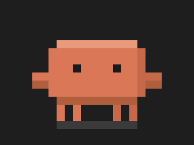

<div align="center">



# ✻ Clawd Pet

**Крихітний цундере-улюбленець із пікселів, що живе в панелі поруч із чатом Claude Code.**
Крокує, поки Claude працює, дрімає, коли тебе немає, червоніє, коли ти його тицяєш, і говорить хмарками, як у коміксі.

[English](README.md) · **Українська** · [日本語*](README.ja.md) · [한국어*](README.ko.md)

<sub>Неофіційний фанатський мод. Не пов'язаний з Anthropic, не схвалений і не спонсорований ним.
«Claude» і «Claude Code» — торгові марки Anthropic. Піксель-арт улюбленця створено саме для цього проєкту.</sub>

<sub>\* Машинний переклад, може містити помилки.</sub>

</div>

---

## Що він уміє

| | |
|---|---|
| 🐾 **Живе поруч із чатом** | Бічна панель з анімованим піксельним улюбленцем: у терміналі — з текстових клітинок, у десктопному застосунку Claude — чіткою картинкою. |
| 🖱️ **Клікни по ньому** | Сердечка, сором'язливість або цундерське «хмф!» з відвертанням. Найкращі друзі іноді бачать зірочки в очах. |
| 💬 **Хмарки з репліками** | Вітається на початку сесії, і привітання висить до твого першого запиту. Коментує завдання, інструменти, помилки й готові відповіді, а на простої нудьгує. За замовчуванням — вбудовані фрази, за бажанням — фрази від ШІ. |
| 💞 **Прихильність** | Що більше спілкуєтесь, то він ніжніший: чотири рівні стосунків змінюють, які реакції ти бачиш. Зберігається між сесіями. |
| 😴 **Спить** | Засинає після кількох хвилин тиші (із «Zzz»). Клікни — прокинеться й буде запевняти, що не спав. |
| 🎭 **Емоції** | Пускає сльозу, коли інструмент падає, підстрибує, коли відповідь готова, лякається, коли ти зупиняєш Claude. |
| 🌅 **Вітання** | Вітається залежно від часу доби й має думку про сесії о третій ночі. |
| 🎨 **Шість кольорів** | Класика, М'ята, Лаванда, Небо, Золото, Ніч — акцентний колір панелі змінюється разом із ним. |
| 🧹 **Чистий чат** *(за бажанням)* | Переносить рядки інструментів, спінер і підказки в панель, а над кожною відповіддю ставить заголовок — у чаті лишається тільки розмова. |
| 📊 **Використання** | Заповненість контексту зі шкалою, ліміти на 5 годин і 7 днів із часом скидання та оцінка вартості сесії. |
| ⚡ **Швидкі команди** | `/compact`, `/context`, `/usage` і `/model` в один клік. Нічого, що стирає чат. |
| 🌍 **Будь-яка мова** | Українська, англійська, японська й корейська вбудовані й вибираються автоматично. Будь-яка інша — на запит: ШІ один раз перекладає Clawd за твоєю згодою (крім російської — на те є причини). |

## Встановлення

У рядку вводу Claude Code в терміналі:

```
/plugin install clawd-pet --marketplace y-teitelman/clawd-pet
```

Відповідай `y`, щоб додати marketplace, і вибери, для кого встановити (для себе чи для одного проєкту).

Або з командного рядка:

```
claude plugin install clawd-pet --marketplace y-teitelman/clawd-pet
```

Перезапусти Claude Code або відкрий нову сесію. Під час першого запуску улюбленець відкриє налаштування — вибери, що подобається, і натисни **Готово**.

> Панель відкривається сама, якщо термінал ширший за 144 колонки. У вужчому вікні введи `/clawd`.

## Команди

| Команда | Що робить |
|---|---|
| `/clawd` | Відкрити панель |
| `/clawd-settings` | Відкрити налаштування (або кнопка **☰** у заголовку панелі) |
| `/clawd-chat` | Увімкнути чи вимкнути чистий чат |

## Налаштування

Усе можна змінити будь-коли через **☰** або `/clawd-settings`, і все зберігається між сесіями.

| Налаштування | Варіанти | За замовчуванням |
|---|---|---|
| Мова | Авто · Українська · English · 日本語 · 한국어 · Своя… | Авто |
| Фрази від ШІ | Вимк · Увімк | **Вимк** |
| Показувати ШІ мій запит | Вимк · Увімк *(видно, коли фрази від ШІ увімкнено)* | Увімк |
| Балакучість | Часто · Звичайно · Рідко · Мовчки | Звичайно |
| Чистий чат | Вимк · Увімк | Вимк |
| Прихильність | Вимк · Увімк | Увімк |
| Улюблена реакція | Випадково · Сердечка · Сором · Цундере *(видно, коли прихильність вимкнено)* | Випадково |
| Колір | Класика · М'ята · Лаванда · Небо · Золото · Ніч | Класика |
| Засинати через | Ніколи · 5 · 15 · 30 хв | 5 хв |
| Вітатися за часом доби | Вимк · Увімк | Увімк |
| Емоції на події | Вимк · Увімк | Увімк |
| Блок використання | Вимк · Увімк | Увімк |
| Швидкі команди | Вимк · Увімк | Увімк |

**Мова «Авто»** спершу береться з мови системи, а далі підлаштовується під мову, якою ти пишеш запити.

**Мова «Своя…»** питає назву будь-якої мови (якою завгодно мовою) і після твоєї згоди один раз перекладає все, що показує Clawd, за допомогою ШІ (близько 10 тис. токенів Haiku). Переклад зберігається; коли оновлення принесе нові слова, налаштування запропонують перекласти заново. Російська недоступна.

**«Скинути налаштування»** внизу налаштувань повертає все до початкового після підтвердження; прихильність і переклад лишаються.

## Прихильність

Кожен клік і кожна завершена відповідь трохи підвищують прихильність (з денним лімітом, тож спам не допоможе). Чотири кліки за десять секунд її знижують. У панелі вона показана сердечками:

| Рівень | Сердечка | Що бачитимеш найчастіше |
|---|---|---|
| Стримано | ♥♡♡♡♡ | цундере |
| Знайомі | ♥♥♡♡♡ | усього потроху |
| Друзі | ♥♥♥♡♡ | сердечка й рум'янець |
| Найкращі друзі | ♥♥♥♥♥ | сердечка й рідкісні ✨ зірочки в очах |

Якщо вимкнути прихильність, можна натомість вибрати улюблену реакцію. Кнопка **«Скинути прихильність»** — у налаштуваннях, і вона спершу питає підтвердження. Кнопка **?** біля сердечок показує ці правила просто в панелі, разом із тим, що вже зараховано сьогодні.

## Фрази від ШІ: ціна і приватність

Фрази від ШІ **за замовчуванням вимкнено**. Якщо їх увімкнути:

- Кожна фраза — один короткий запит до **Claude Haiku** з облікових даних твоєї сесії Claude Code, і він рахується в її використанні (`/usage` показує, скільки припало на моди). Фраза — це приблизно 60 токенів відповіді; ліміт — 200 фраз за сесію, після нього — вбудовані фрази.
- Щоб коментувати, що відбувається, модель бачить: назву інструмента й коротку мітку (команду, назву файлу чи шаблон пошуку), скільки тривала відповідь і — тільки якщо увімкнено **«Показувати ШІ мій запит»** — перші 200 символів твого запиту.
- Більше нікуди нічого не надсилається. Із вимкненими фразами від ШІ не надсилається нічого.

## Чистий чат

Коли він увімкнений, у чаті лишаються тільки твої повідомлення й відповіді Claude, кожне під своїм заголовком. А панель натомість показує:

- **Стан:** що Claude робить просто зараз, із таймером
- **Дії:** кожен виклик інструмента, `✓` готово, `✗` помилка
- **Підказки:** рядок статусу, позначки режимів і підказки з-під поля вводу (режим доступу лишається під полем вводу, де його перемикає shift+tab)

Інструменти, що завершились помилкою, і запити дозволу завжди лишаються в чаті. **ctrl+o** будь-коли показує повний лог.

## Вимоги

- Claude Code з підтримкою модів (hooks module)
- **У терміналі:** true color. На Windows використовуй **Windows Terminal**; у старій консолі пікселі можуть малюватися криво. На macOS найкраще працюють iTerm2, Ghostty чи WezTerm.
- Для кліків термінал має передавати мишу програмам (Windows Terminal, iTerm2 і більшість терміналів Linux це вміють).
- **У десктопному застосунку Claude:** працює одразу, з кліками. Спокій, робота й сон анімуються всередині самої картинки, тож панель перемальовується лише на події.

## Якщо щось не так

- **Немає панелі?** Введи `/clawd`. Якщо термінал вужчий за 144 колонки, панель чекає, поки її покличуть.
- **Улюбленець смугастий або не тих кольорів?** Схоже, твій термінал підтримує лише 256 кольорів. Спробуй термінал із true color.
- **Рядки підсвічуються під мишкою?** Звичайним текстом намальовані лише краї улюбленця, а тіло — так, щоб підсвітку терміналу не було видно. Якщо ти все одно її бачиш, твій термінал малює підсвітку по-своєму.

## Історія версій

Що змінилося в кожній версії — у [CHANGELOG.md](CHANGELOG.md) (англійською). Кожна версія також є [релізом на GitHub](https://github.com/y-teitelman/clawd-pet/releases); щоб дізнаватися про нові, стеж за репозиторієм (Watch → Custom → Releases).

## Для розробників

```
claude plugin validate .          # перевірити маніфест і модуль
claude plugin test .              # запустити tests/
node scripts/render-assets.mjs .  # перемалювати assets/icon.png і assets/demo.gif з коду спрайта
```

Спрайт малює одна чиста функція між позначками `// <sprite>` у `hooks/register.tsx`; скрипт для картинок рендерить той самий код, тож README завжди показує справжнього улюбленця.

---

<div align="center"><sub><a href="LICENSE">MIT License</a> · by <a href="https://github.com/y-teitelman">KypiCTiHka</a> · made with ♥ and a lot of pokes</sub></div>
